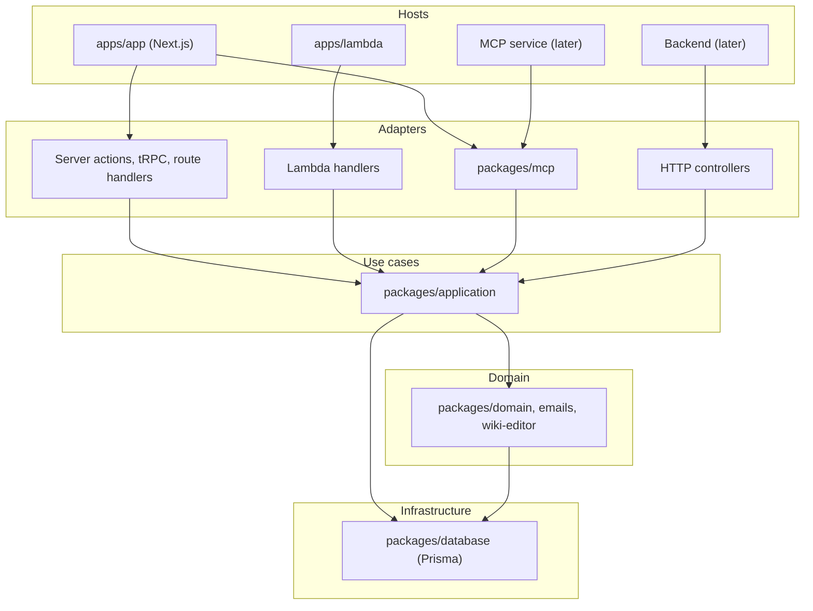

# Architecture

This document tells where the code lives today, where it moves to, and the rules that keep the direction. It is a living document: update it when a package or a layer changes.

## Current layout

The monorepo (`pnpm-monorepo`) has two groups of workspace packages.

### Hosts (`apps/*`)

A host is a deployable program. It owns its runtime, its configuration and its entry points.

| Host | Runtime | Role |
| - | - | - |
| `apps/app` | Next.js on Vercel | The web app: pages, server actions, tRPC, route handlers, the login (next-auth), the OAuth authorization server and the MCP endpoint |
| `apps/lambda` | AWS Lambda | Automations and the notification router: `email-function`, `frequent-automations`, `midnight-automations`, `notification-router`, `scrape-discord-events` |
| `apps/collab` | Node.js container | The realtime backend of the wiki (Hocuspocus) |
| `apps/scripts` | Node.js | One-off maintenance scripts |
| `apps/playwright` | Node.js | The end-to-end test suite with its own stack |

### Shared packages (`packages/*`)

| Package | Layer | Content | Depends on |
| - | - | - | - |
| `database` | infrastructure | The Prisma schema, the migrations and the generated client | — |
| `domain` | domain | Pure rules and helpers that more than one host uses: audit event types, calendar dates, time zone, event rules, wiki rules, read markers, the limits of the forms and the use cases, the slug helper. The permission model (`src/permissions`): permission sets, role resolution, the wiki page permission resolvers. The notification vocabulary (`src/notifications`): the payload schemas of the on-site notifications and the realtime channel names | `database` (types) |
| `emails` | domain | The email templates | — |
| `wiki-editor` | domain | The Tiptap schema of the wiki content, text extraction, the Markdown renderer and parser | — |
| `application` | use cases | The use cases: one read or one write of a feature, with the permission checks, the audit events and the notifications inside. The actor, the application context and the typed errors. The OAuth use cases. See the [package README](../pnpm-monorepo/packages/application/README.md). | `database`, `domain`, `wiki-editor` |
| `mcp` | interface adapter | The MCP server: the tool registry, the tools, the request handler with the bearer verification. See [mcp-server.md](./mcp-server.md). | `application`, `domain`, `database` |

### Inside the Next.js app

`apps/app/src/modules/<feature>/` holds the code of a feature: `queries/` (reads), `actions/` (server actions, the writes), `components/`, `utils/`. `apps/app/src/app/` holds the routes and the pages, which compose the modules.

Four modules are adapters of the packages, not features:

- `modules/application`: the composition root. `getApplicationContext()` builds the one context of the app from the existing modules (Prisma, audit, notifications, logging, tracing, changelog, collab, URLs, signing key). `toActor(session)` maps the next-auth session to the actor of the use cases, and `getRequestActor()` gives the actor of the current request to the pages and queries. Two helpers map the typed errors to action responses and to `forbidden()` / `notFound()`.
- `modules/oauth`: the consent page, the token and revocation endpoints and the metadata documents.
- `modules/mcp`: the `/api/mcp` route.
- `modules/mcp-settings`: the account page `/app/account/mcp` (the connected clients and the tool settings).

Where a feature already has use cases, the module keeps a thin wrapper per query or action: it builds the actor from the session, calls the use case, and keeps the app-specific parts (React `cache()`, `FormData` parsing, translations, `refresh()`, `forbidden()`).

## Target architecture

The direction is a pragmatic reading of Clean Architecture. The rules of the organization and the use cases of the system are independent of the hosts. A host is a thin adapter: it authenticates, builds the actor and the context, calls a use case, and shapes the response for its transport.

Dependencies point downwards only. A package never imports a host. `application` never imports `mcp` or `next`. `domain` never imports `application`.

### The layers

- **Domain** (`domain`, `emails`, `wiki-editor`): pure code. No Prisma client calls, no I/O. Prisma types and selects are permitted.
- **Use cases** (`application`): `(context, actor, input) => output`, with the context and its ports as the [package README](../pnpm-monorepo/packages/application/README.md) describes them. The use cases call Prisma directly; there are no repository ports. This is the one intentional break of the dependency rule, decided for pragmatism.
- **Adapters**: the server actions and tRPC procedures of the Next.js app, the MCP tools and request handler, the Lambda handlers. They parse the transport-specific input, call the use cases and map the typed errors.
- **Hosts**: the deployables. Each host has one composition root that builds its context.

### What moves, and where to

| Today | Target | Why |
| - | - | - |
| Business logic in `apps/app/src/modules/*/actions` and `queries` | Use cases in `application`; the app keeps thin wrappers | The MCP server, the Lambdas and a later backend call the same logic |
| The audit writer, the notification trigger, the logger and the tracer in `apps/app/src/modules` | Packages with ports; each host adapts them in its context | The later MCP service and the backend need the same services |
| Permission checks in pages and components | Inside the use cases; the pages keep their gates as a second check | A new host cannot forget a check that the use case does |
| Lambda automations that use Prisma and the app's rules | Use cases in `application`, called from thin Lambda handlers | One implementation of each rule |
| The MCP endpoint in `apps/app` | A service of its own that imports `mcp` and `application` and builds its own context | Independent scaling and deployment |
| The Next.js app with all business logic | A dedicated backend with Next.js as a backend-for-frontend (open decision) | Only when a second frontend or a scaling need makes it necessary |
| `packages/permissions` | Done: folded into `domain` (`src/permissions`) | It is domain code with the same dependencies as `domain`; one package has less to maintain. |
| `packages/notifications` | Done: folded into `domain` (`src/notifications`) | Same reason as `permissions`. |
| `packages/wiki-editor` | Stays a separate domain-level package | It is domain code (the content format of the wiki), but it depends on Tiptap and has a browser entry (`helpers`). A merge into `domain` would pull Tiptap into the Lambdas and the collab server. |
| `packages/emails` | Stays separate as an adapter | Email templates are presentation, not rules. A use case asks the context to send a notification; the template renders it. |

### How to move a piece of logic

1. Put the pure rules into `domain` (or the fitting domain package) if the Lambdas or the collab server could use them.
2. Write the use case in `application/src/<feature>/`: the Zod input schema next to it, an explicit plain output, the permission checks with `requirePermission`, the audit events and the notifications through the context.
3. Make the app query or action a thin wrapper: the same export name and signature where practical, the actor from the session, the use case call, the app-specific response.
4. Delete the moved logic from the app. Never keep two copies.
5. Keep the end-to-end tests green without changes: the behavior of the app does not change.

The remaining actions and queries of the app are listed as a follow-up in the application README after each rollout.
